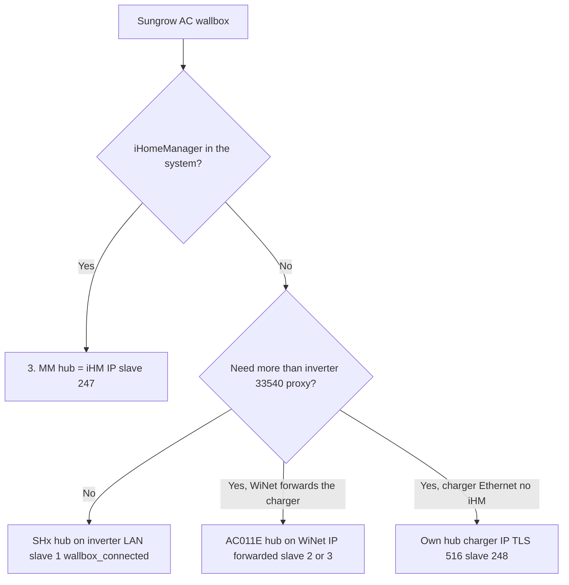

# Sungrow AC wallbox connection topologies

Applies to **AC007-00**, **AC011E-01**, and **AC22E-01**.

This page is about **wiring and which Modbus endpoint Home Assistant should use**. Surplus charging in iSolarCloud is Sungrow EMS behaviour.

Pick **one** charger-control path. Do not combine charger Ethernet and charger RS485 at the same time. Do not point two Modbus masters at charger **:516**.

## What the inverter hub can see

The **inverter Ethernet port** is **not** a transparent Modbus TCP-to-RTU bridge ([#127](https://github.com/TCzerny/ha-modbus-manager/issues/127)). On that IP it answers:

- **Slave 1** — hybrid (SHx template)
- Mapped internals such as **SBR slave 200**
- Wallbox **proxy** **`33540–33549`** on slave **1** if SHx **`wallbox_connected = yes`** (short EMS mirror)

It does **not** forward `21xxx` to a physical RS485 charger (native unit **248**, or logger IDs **2 / 3**). Those reads time out on the inverter IP.

The full charger map (`21xxx`, AC011E template) needs a path that actually addresses the wallbox:

| # | Topology | What you get | MM hub | Template |
| --- | --- | --- | --- | --- |
| **1** | [RS485 to hybrid](#1-rs485-wallbox--inverter) | Proxy only on inverter LAN. Full `21xxx` via **WiNet-S forwarding** | SHx on inverter IP; AC011E on **WiNet IP** (or the same WiNet hub) | SHx `wallbox_connected`; AC011E slave = **WiNet device list** (often **2** or **3**, confirm) |
| **2** | [Direct LAN TLS](#2-direct-connection-lan-tls) | Full `21xxx` on the charger | **Own** hub, charger IP | AC011E, TLS, port **516**, slave **248** (HA 2026.9+) |
| **3** | [iHomeManager](#3-with-ihomemanager) | iHM charger entities, not `21xxx` | Hub to the **iHM** | [iHomeManager](README_iHomeManager.md), **`charger_enabled`**, slave **247** |



**SH-RT** can use **1** (RS485 + optional WiNet for `21xxx`) or **2** (charger LAN). **SH-T / larger hybrids + AC22E** generally need **3**; Sungrow does not support charger↔inverter RS485 there.

---

## Charger ports (AC22E-01)

Physical labels (Roman numerals) are easy to mix up:

| Label | Function | Typical use |
| --- | --- | --- |
| **I** | Ethernet (LAN) | Topology **2** (MM TLS) or topology **3** (iHM / cloud) |
| **II** | RS485 port 1 | Topology **1** (hybrid) **or** a third-party RS485 EMS — **not both** |
| **III** | RS485 port 2 | Optional energy meter (rarely needed) |

Set working mode to **EMS** for Modbus/EMS control.

On the charger’s **own IP**:

| Port | Typical behaviour |
| --- | --- |
| **502** | Closed or not usable Modbus (`connection refused`) |
| **516** | Open, **TLS**. Plain Modbus is reset. |

Port **502/516 on the WiNet dongle** is the **inverter logger**, not the wallbox. Topology **2** must use the **charger** LAN IP.

---

## 1. RS485 wallbox → inverter

Sungrow’s documented path for **SH-RT + AC011E/AC22E** without iHM: **RS485 from charger port II to the inverter**.

### 1a. Inverter LAN / SHx hub — proxy only

Hub **host = inverter built-in LAN**, port **502**, SHx slave **1**, **`wallbox_connected = yes`**.

You get **`33540–33549` only**. Adding an AC011E device on **this** hub (slave 2, 3, or 248) does **not** work: the inverter does not route those units onto RS485 ([#127](https://github.com/TCzerny/ha-modbus-manager/issues/127)).

```text
[HA / MM] -- TCP :502, slave 1 --> [Inverter LAN]
                                      |
                                   RS485 (charger port II)
                                      |
                              [Wallbox]   inverter mirrors a few 33xxx words only
```

### 1b. More than the proxy: WiNet-S forwarding

**WiNet-S** is the component that acts as a Modbus TCP proxy for other units. Enable Modbus **502 without encryption** on the dongle.

Read the charger’s **Forwarding Modbus ID** in **WiNet web UI → Device → Device List**. Live [#127](https://github.com/TCzerny/ha-modbus-manager/issues/127): **2**. Other installs (and MKaiser’s WiNet path) often use **3**. Do not assume 3.

Then add the **AC011E** template on a hub whose **host is the WiNet-S IP** (port 502, TLS off), slave = that forwarding ID. That can be:

- a **second MM hub** next to the SHx hub on inverter LAN (different IPs — this is what worked in #127), or
- the **same** hub if Home Assistant already talks to **WiNet** for the hybrid (one TCP client, two devices: inverter unit 1 + charger forwarded id)

Do **not** open a second hub to the **same** WiNet IP:502 (second TCP client on the logger).

```text
[HA / MM] -- TCP :502, slave 1 ----------> [Inverter LAN]     SHx + 33540
[HA / MM] -- TCP :502, slave 2 or 3 -----> [WiNet-S] -------> RS485 wallbox 21xxx
```

Whether WiNet `21xxx` writes **collide** with inverter EMS on the same RS485 charger is **not settled**. Prefer read-only first.

MKaiser’s WiNet survey also sees the charger as a forwarded unit (commonly **3**), not as **248**. Native **248** is the charger’s own address on its RS485/TLS side, not the logger forwarding ID.

### Optional: RS485 USB / Waveshare only (no inverter on that bus)

Third-party control sometimes talks to charger slave **248** on RS485 (9600 8N1) via USB-RS485 or a Waveshare gateway. That is **not** charger Ethernet and **not** inverter LAN. MM: serial or RTU-over-TCP to the **adapter**, slave **248**, AC011E template. Do not share that segment with the inverter or iHM.

---

## 2. Direct connection LAN TLS

No iHM. Charger on **Ethernet (port I)** — typically **instead of** RS485 to the inverter (do not run LAN and RS485 together).

The charger has **no** usable Modbus on **:502**. It answers **Modbus TCP inside TLS on :516** as **unit 248** (MKaiser AC22E direct path; same port/unit for AC011E).

Create a **dedicated Modbus Manager hub** (charger IP, not WiNet, not inverter LAN):

| Setting | Value |
| --- | --- |
| Host | **Charger** LAN IP |
| **TLS** | On (HA **2026.9+**; hidden on older cores) |
| Port | **516** (502 is rewritten to 516 when TLS is on) |
| Slave ID | **248** |
| Template | Sungrow AC011E Wallbox (`21xxx`) |

```text
[HA / MM] -- TLS :516, unit 248 --> [Wallbox LAN IP]
[HA / MM] -- TCP :502, unit 1 ----> [Inverter LAN]   separate SHx hub
```

Older Home Assistant cannot open this link. Do **not** use it if **iHomeManager** already holds charger **:516**.

---

## 3. With iHomeManager

iHM **is** the EMS. It discovers the charger on the LAN (typically TLS on charger **:516**). Home Assistant must poll and command the **iHM**, not the charger and not inverter wallbox proxy registers.

```text
[HA / MM] -- plain TCP :502 or :503, slave 247 --> [iHomeManager]
                                                       |
                                                  TLS :516
                                                       |
                                                  [Wallbox]
```

Enable **Modbus TCP on the iHM** (installer / system parameters). Some units use **:502**, others **:503** if 502 is busy; leave **SSL off** on that iHM port. Slave ID is typically **247**. Template **iHomeManager**, option **`charger_enabled`**.

RS485 charger↔inverter is **unsupported** with iHM and can raise inverter alarms (e.g. 2661).

**Inverter `33540–33549` stay frozen.** Mode changes show up on iHM **8047** (Fast / ECO / …), as in [discussion #92](https://github.com/TCzerny/ha-modbus-manager/discussions/92).

Do **not** also load the AC011E template against the charger IP (topology **2**) or WiNet forwarding. Port **516** is already the iHM session.

WiNet **516 + SSL** on the **inverter** side is so iHM can reach the plant. That is not the MM hub.

### iHM charger registers in Modbus Manager

Protocol: *Communication Protocol of iHomeManager* V1.0.1 / V1.0.2 (Sungrow register numbers = address + 1). Extra power registers from live scan [#86](https://github.com/TCzerny/ha-modbus-manager/issues/86).

| Function | Address (MM) | Notes |
| --- | --- | --- |
| Charging status | **8551** | Documented: 1 idle, 2 standby, 3 charging, 6 completed |
| Charging modes | **8047** | Protocol lists Fast/ECO (`160`/`161`); template also EU `162`/`163` and AU `164`–`167` |
| Charger enable | **8048** | `0xAA` / `0x55` |
| Grid power draw (ECO) | **8049** | Protocol: write only in Eco. Template hides it unless mode is **161** / **165** / **166** |
| Active power (total + L1/L2/L3) | **8593–8599** | **Not in the PDF.** Ends officially at 8573–8574. Community-verified. |

GRID.CT voltages/power **8553–8563** are the **iHM meter**, not the wallbox terminals.

### What is not on the iHM map

Protocol table of contents lists **§3.4 Charger Control**, but that section is **missing** from the V1.0.2 PDF. The published RW table stops at modes / enable / grid-draw.

[#86](https://github.com/TCzerny/ha-modbus-manager/issues/86) scanned **8574–8773** during a ~4 kW session: **no accumulating energy register**. Session/lifetime kWh: Riemann / `utility_meter` on `charger_active_power`. Direct charger `21299` / `21309` would need topology **2** on **:516**, which iHM already uses.

Not on iHM (charger `21xxx` only): setpoint current **21202**, phase switch **21203**, remote start/stop **21211**, per-phase V/I, session timestamps, device type.

Possible later template tweaks (not implemented): extend `charger_status_raw` options with wallbox codes 4/5/7/8/9 if they appear on iHM; Riemann helper recipe for kWh.

---

## What to configure in Modbus Manager

| # | Topology | Host | Port | Type | Slave | Template |
| --- | --- | --- | --- | --- | --- | --- |
| **1a** | Inverter LAN (proxy) | **Inverter** LAN IP | 502 | TCP | **1** | SHx, **`wallbox_connected`**. No AC011E on this hub |
| **1b** | WiNet forwarding (full `21xxx`) | **WiNet-S** IP | 502 | TCP | **Forwarding ID** (often **2** or **3**) | AC011E. Not inverter LAN. See [#127](https://github.com/TCzerny/ha-modbus-manager/issues/127) |
| **2** | Direct LAN TLS | **Charger** IP | 516 | TLS (HA 2026.9+) | **248** | AC011E on its **own hub** |
| **3** | iHomeManager | **iHM** IP | 502 or 503 | TCP | **247** | iHomeManager, **`charger_enabled`** |
| — | RS485 USB / Waveshare only | Adapter / gateway | 502 or serial | RTU / RTU-over-TCP | **248** | AC011E (not charger Ethernet, not inverter LAN) |

---

## Related

- Template entities: [README_sungrow_ac011e_wallbox.md](README_sungrow_ac011e_wallbox.md)
- iHM registers / `charger_enabled`: [README_iHomeManager.md](README_iHomeManager.md)
- Inverter LAN does not forward the charger: [#127](https://github.com/TCzerny/ha-modbus-manager/issues/127)
- iHM vs charger TLS: [discussion #92](https://github.com/TCzerny/ha-modbus-manager/discussions/92)
